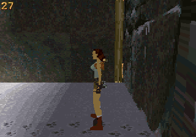
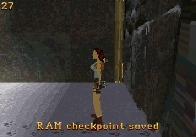
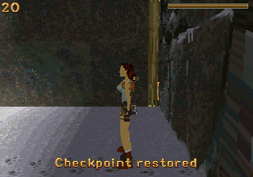

# Standalone 32X audio and further rendering improvements

> Historical audio build before CPU workers. See [the current CPU worker report](cpu-workers.md).

This fork adds sound effects without requiring Sega CD. It retains XProger's
fixed-point engine and dual-SH-2 renderer. Tested November 2, 2026 with PicoDrive
commit `1890c2932234c9d30f4cd3851d02228baae8f09e` and marsdev GCC 13.1.0.
No physical-console measurements are available.

| NTSC replay | Original upstream | First renderer build | Latest build with audio |
|---|---:|---:|---:|
| Opening view | 20.00 FPS | 24.00 FPS | 26.84 FPS |
| Turning | 22.44 FPS | 26.13 FPS | 26.50 FPS |
| Movement | 18.84 FPS | 19.66 FPS | 18.59 FPS |

The opening improves 34.2% over upstream and turning improves 18.1%. Movement
is 1.3% slower than upstream while playing 67 effects, with up to three voices
overlapping. This is a real tradeoff: the audio build is not faster in every
scene. Further tuning should target the mixer and movement/animation cost.
The first renderer build and its historical results remain documented in
[report.md](report.md).

Each run lasts 2,400 video frames; the first 480 are excluded. FPS counts
changes of the displayed framebuffer over the remaining 32 NTSC seconds.
All runs use the same core, region, six-button pad and controller replay, with
frameskip and 68000 overclocking disabled. SH-2 clocks use core defaults.
Host execution speed is excluded. Original and latest movement runs finish at
`[73907, 3072, 25049]`; the first renderer build finishes slightly differently.
Inputs are sampled at render boundaries, so these are replay measurements,
not proof of identical work on every frame.

The SH-2 interpreter measures 26.91 FPS for the latest opening, compared with
20.00 FPS upstream. Small timing differences between emulator CPU modes remain.
The latest stationary image differs from the original only in the FPS digits,
within the bounding box `x=13..24, y=3..15`.

| Original | Latest, with audio |
|---|---|
|  |  |

## What changed

The flat-textured loop now draws sixteen pixels per long iteration; the
Gouraud-textured loop draws eight. Short spans and tails keep the pair loop.
A 16 KiB SDRAM shade table stores duplicated output palette bytes as words,
removing byte expansion in the flat-textured inner loop. Resolution, texture
sampling density, draw distance and face scheduling are preserved. The earlier
hardware clipping divider and sprite/glyph allocation fixes are retained.

Sound effects use four software voices at 11,025 Hz, with volume, pitch,
UNIQUE/REPLAY semantics and voice stealing. Two 256-sample buffers feed both PWM
outputs through master-SH-2 DMA channel 1. The IRQ starts the prepared buffer
before mixing the consumed buffer. Mixing reserves 6 dB of headroom; no clipped
samples were counted in the published runs. Output is mono on both channels.

The build extracts effects from the three existing upstream GBA packed levels,
averages adjacent 22,050 Hz PCM samples, deduplicates them and encodes IMA ADPCM.
There are 91 unique effects, 592,276 decoded samples and 296,276 bank bytes.
The decoder reads compressed ROM data on demand. A 1.4 KiB ROM delta table
removes three branches per decoded sample. This adds no new downloaded assets
or music data. Generated bank/header files are ignored by git and rebuilt by
Python automatically; GNU make 4.3 or newer is required.

The former watchdog clock is replaced by VBlank-derived milliseconds. This
also avoids competing internal watchdog/DMA interrupts in the tested PicoDrive
SH-2 core, which has a single pending internal-interrupt slot. A 60-second run
reaches 2,578 completed audio blocks without the earlier interruption. Soft
reset explicitly stops DMA/PWM before recopying SDRAM, then restarts audio at
the title. These changes are part of the port; the emulator core is unmodified.

The playable ROM is still 4 MiB. The ELF contains 17,020 initialized SDRAM bytes
and 224,412 BSS bytes: 241,432 static bytes total, leaving 20,712 bytes of 256 KiB
SDRAM for stacks and remaining use. The linker reserves stack space. This is
tighter than the first renderer build and merits hardware stress testing.

## Verification

- A clean parallel build in a fresh worktree regenerates audio assets and
  completes without warnings.
- Original and latest rasterizers match across 2,556 synthetic cases:
  FT `1300929039`, GT `1388686019`. All 4,096 signed divider comparisons pass.
- The complete runtime ADPCM decoder produces hash `1623845143` over all
  592,276 samples, matching independent CPython `audioop.adpcm2lin` decoding
  after nibble-order conversion. Raster, divider and audio checks pass with
  both the recompiler and interpreter.
- Caves, City of Vilcabamba and Lara's Home load their own data and effects.
  Home's stationary replay reaches 30 FPS; Vilcabamba's reaches 20 FPS.
- Saving a 1,488-byte checkpoint, moving and restoring twice returns Lara to
  `[75264, 3072, 3584]`. Reset returns to the title, clears the checkpoint and
  resumes DMA. Restoring without a checkpoint also leaves gameplay running.
- A PAL movement/audio run completes 2,400 frames with 56 effects and no counted
  clipping. It is a smoke test; a paired PAL performance claim is not made.

| Saved checkpoint | Restored checkpoint |
|---|---|
|  |  |

Raw numbers, source/core/toolchain hashes and caveats are in
[results-v2.json](results-v2.json) and [benchmarks-v2.csv](benchmarks-v2.csv).
The delivery archive contains original, first renderer and latest audio ROMs,
symbols/maps, replay inputs, raw emulator results, a PCM capture, build logs
and an upstream-applicable source patch. See the
[build/controls README](../../src/platform/32x/README.md) for reproduction.

## SH-2 math and optional Sega CD

SH4ZAM targets the Dreamcast SH-4's floating-point/vector facilities. The 32X
SH-2 has integer multiply/accumulate and a hardware divider, with no equivalent
SH-4 FPU vector instructions. SH4ZAM is not a drop-in acceleration library for
32X. Appropriate techniques here are fixed-point assembly, lookup tables,
careful memory placement and measured use of both CPUs; the original port
already applies many of them. Sources:
[SH4ZAM](https://github.com/gyrovorbis/sh4zam),
[Hitachi SH7604 hardware manual](https://antime.kapsi.fi/sega/files/sh7604.pdf).

An optional Sega CD backend could provide CD-DA music, PCM ambience and more
asset storage. Its sub-CPU and Word RAM require explicit transfers and
synchronization; they are not transparent extra SH-2 memory or a replacement
for this polygon rasterizer. Offloading audio might free some SH-2 time, but
that is an unmeasured design possibility, not an established FPS gain. Sega's
[CD manuals](https://www.megadrive.org/elbarto/megacd/Official%20Sega%20CD%20Manual/segacd_toc.html)
document those separate audio, memory and communication facilities.

The current build does not implement or require Sega CD. Existing disabled CD
scaffolding is not a working backend. Any future CD support should preserve
standalone boot/gameplay/effects, use bounded detection and fall back when the
drive or disc is absent. No CD BIOS or disc was used in these tests.

Music playback, persistent saves/settings, the remaining campaign levels,
full-game completion and real 32X validation remain outstanding. Emulator
results cannot establish hardware DMA/cache timing, cartridge compatibility,
audio fidelity or sustained console FPS.
