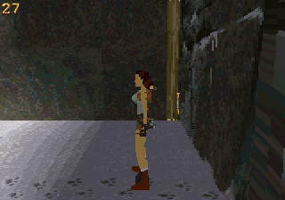
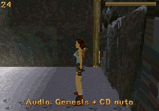

# Genesis and optional Sega CD CPU workers

The Genesis 68000 now performs useful background audio decoding/resampling at
stock clocks. An opt-in Sega CD worker can share that work. The same 4 MiB ROM
boots and plays without Sega CD, a disc, or an overclock modification.

This is a measured incremental improvement, not full utilization of every CPU
or a claim of universal speedup. Tests use PicoDrive commit
`1890c2932234c9d30f4cd3851d02228baae8f09e` and marsdev GCC 13.1.0. Physical
Genesis/32X/CD validation remains outstanding.

| NTSC replay | Original upstream | Previous audio build | Genesis worker build |
|---|---:|---:|---:|
| Opening view | 20.00 FPS | 26.84 FPS | 26.84 FPS |
| Turning | 22.44 FPS | 26.50 FPS | 26.72 FPS |
| Movement | 18.84 FPS | 18.59 FPS | 18.97 FPS |

Movement improves 2.0% over the previous audio build; turning improves 0.8%.
The opening result is unchanged. Both SH2 clocks and the Genesis clock remain
at the emulator's stock settings; frameskip and 68000 overclocking are disabled.
Each run lasts 2,400 video frames with the first 480 excluded. FPS counts
displayed-framebuffer changes over the remaining 32 nominal NTSC seconds,
using the same replay and core. Host speed is excluded.

Original, previous audio and latest movement runs end at
`[73907, 3072, 25049]`. Inputs are sampled at render boundaries; equal final
positions do not establish identical intermediate work. This remains a replay
comparison. See [results-v3.json](results-v3.json) and
[benchmarks-v3.csv](benchmarks-v3.csv) for exact values and hashes.

## Division of work

| Processor | Work in this build |
|---|---|
| Master SH2 | Gameplay, renderer work, current-volume audio mixing, PWM DMA and fallback decoding |
| Slave SH2 | Existing framebuffer clearing and polygon rendering |
| Genesis 68000 | Controllers/support commands plus up to two predicted decoder/resampler blocks |
| Sega CD 68000, optional | One decoder/resampler block while the Genesis processes the other |

The Genesis decoder and its transition tables execute from Genesis work RAM,
reducing cartridge instruction-fetch contention. The two 68000s share an exact
integer assembly decoder. It uses a precomputed signed-delta/next-state table
and retains clipping, nibble ordering, predictor and pitch semantics. The
Genesis has a C fallback for source spans crossing a cartridge bank boundary.

The SH2 submits a small descriptor in bounded three-word handshakes. The
Genesis computes up to two 256-sample predictions and sends PCM back in
four-word FIFO groups, using master SH2 DMA0. One-voice packets omit unused
voice data. The master invalidates the corresponding cache lines after DMA,
applies current volume, and mixes through a voice-major accumulation loop.
Hot audio routines reside in SH2 SDRAM. DMA1 retains the double-buffered PWM
output, four voices, 11,025 Hz and the previous 6 dB headroom.

Only descriptor acknowledgements are briefly waited on in the audio IRQ;
decoder completion is asynchronous. A result is consumed only when its source,
position, decoder state and pitch still match the live channel. Late or stale
results use native SH2 decoding. A stuck Genesis worker disables offloading;
controller VBlank handling and SH2 audio continue. The movement replay consumes
873 worker voice blocks with zero worker faults. It also encounters 50 late
deadline checks and rejects 102 stale voice blocks, demonstrating why the
fallback remains necessary.

## Optional CD mode

Genesis offloading is the default. **Start + Y** during gameplay cycles through:

1. Genesis + CD auto, experimental.
2. SH2-only decoding.
3. Genesis decoding, the default again.

CD auto checks known firmware signatures when work is first available. If a
supported CD is present, it resets the sub-CPU and loads a private program into
PRG-RAM. That program uses its own vectors and stack, calls no BIOS or drive
functions, reads no disc and never accesses backup RAM. A fresh boot token
prevents accepting old readiness state after a console reset.

The Genesis copies one job's descriptor and compressed bytes into Word RAM,
hands ownership to the CD, and decodes another voice in its own RAM. The CD
returns Word RAM before announcing completion. The Genesis bridges the results
back through the 32X FIFO. Bounded timeouts and the Genesis/SH2 fallbacks handle
absent, unsupported or unresponsive workers. Reset restores default Genesis
mode; CD use requires selecting the optional mode again.

The CD CPU does help the isolated decoder workload:

| Verified 273-batch test | Genesis | Genesis + CD |
|---|---:|---:|
| Emulated video frames | 680 | 603 |
| Nominal elapsed time | 11.33 s | 10.05 s |
| Compared output voice blocks | 546 | 546 |
| Sample/state errors | 0 | 0 |

That is 11.3% less elapsed time for this synthetic workload, including transport
and SH2 reference verification. It is not a gameplay FPS result. The paired
movement tests with the same CD attachment measure **18.53 FPS in Genesis mode
and 18.44 FPS in CD auto mode**. CD bridging and synchronization have costs;
this replay demonstrates no FPS benefit. CD mode therefore remains experimental
and opt-in. It completed 891 CD-assisted batches in that gameplay run.

## Validation and limits

- A fresh parallel build regenerates the audio bank and both workers' tables.
  The ROM remains 4 MiB. Linker guards protect the Genesis and SH2 stacks.
- Worker tests cover all 91 effects at initial, partial and end positions,
  with increments 32–1024. All 273 jobs / 546 voice blocks match the SH2
  reference sample-for-sample and in final decoder state, with and without CD.
  Both SH2 recompiler and interpreter produce zero errors.
- The full SH2 decoder still matches the independent IMA reference over
  592,276 samples: hash `1623845143`. The reordered mixer matches the previous
  sample-major mixer in 320 cases: zero errors, hash `4267401245`.
- Raster checks retain FT `1300929039`, GT `1388686019` over 2,556 cases;
  all 4,096 signed-divider checks pass. Both CPU modes match.
- A deliberately stalled fourth CD job falls back to Genesis and completes
  all 273 tests without sample errors. A stalled fourth Genesis job disables
  offloading; the movement replay and SH2 audio continue.
- Checkpoint restore, reset, PAL, all three packed levels, a 60-second audio
  run and interpreter gameplay complete. CD mode is also re-enabled successfully
  after reset, completing another 208 CD-assisted batches without worker faults.
- SH2 static RAM is 245,352 bytes: 18,752 initialized plus 226,600 BSS, leaving
  16,792 bytes including the reserved stacks. Genesis static RAM is 18,296
  bytes. The CD worker stays within the first 64 KiB PRG-RAM bank and uses
  less than 5 KiB of Word RAM, while its ownership handshake controls all 2M.

CD tests use an original signature-only firmware fixture and dummy media to
attach PicoDrive's CD hardware through the normal loader. The actual sub-CPU
executes the worker instructions; no emulator source was changed. This validates
the private bootstrap and processor protocol, not retail BIOS/drive behavior or
physical bus/cache timing. The fixture's boot delay also means attached-CD and
standalone gameplay runs should not be treated as a direct CD-speed comparison;
the CD table above compares two runs with the same attachment.

Build, controls and test commands are in the
[32X README](../../src/platform/32x/README.md). The delivery archive includes
previous/current playable builds, symbols/maps, raw results, replay inputs,
audio captures, test builds, logs and an upstream-applicable source patch.
Earlier measurements remain in [the first renderer report](report.md) and
[the previous audio report](audio-performance.md).

Hardware references:
[Sega 32X hardware manual](https://consolemods.org/wiki/images/e/e9/32X_Hardware_Manual_1994_Sega_text.pdf),
[Sega CD manuals](https://www.megadrive.org/elbarto/megacd/Official%20Sega%20CD%20Manual/segacd_toc.html).
Music, persistent saves/settings, the remaining campaign and full-game
completion remain outside this change. No real-console FPS or compatibility
claim is made.
