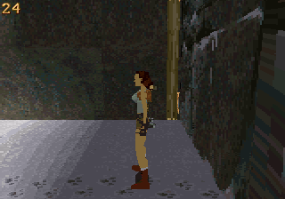
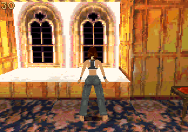
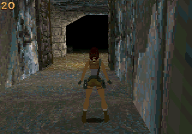
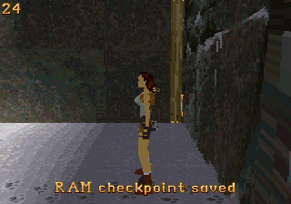
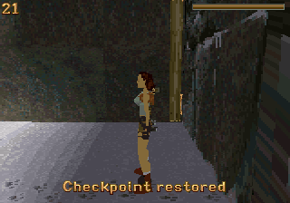

# OpenLara 32X: measured improvements

> Historical first renderer build. See [the current CPU worker report](cpu-workers.md).

Tested November 2, 2026 against upstream commit
`3b268ca4bf986c380f44a26ffd9218bf6d376249` of
[XProger/OpenLara](https://github.com/XProger/OpenLara). These are emulator
measurements of builds from source, rather than measurements from a retail 32X.

| Test | Original | Improved | Change |
|---|---:|---:|---:|
| NTSC opening view | 20.00 FPS | 24.00 FPS | +20.0% |
| NTSC turning replay | 22.44 FPS | 26.13 FPS | +16.4% |
| NTSC movement replay | 18.84 FPS | 19.66 FPS | +4.3% |
| PAL opening view | 25.00 FPS | 25.00 FPS | 0.0% |

The NTSC opening result was also reproduced with PicoDrive's SH-2 interpreter:
20.00 → 24.00 FPS. Improvement varies with the scene; this does not establish
30 FPS gameplay or a universal 20% speedup.

The original and improved opening screenshots differ only within pixels
`x=13..24, y=3..15`, which contain the FPS digits. Lara's final world position
is identical in this stationary replay.

| Original | Improved |
|---|---|
|  |  |

The renderer already used fixed-point arithmetic, reciprocal tables, hand-written
SH-2 transforms and rasterizers, and both CPUs. The secondary processor clears
the framebuffer and draws alternating faces; the CPUs synchronize at populated
depth buckets. The changes retain this division of work and ordering.

The main measured improvement comes from unrolling the flat-textured and Gouraud
texture loops. Each iteration writes eight pixels using the same four two-pixel
samples that the old loop would produce. Short spans and the remaining tail use
the original pair loop. This reduces loop-control instructions without changing
resolution, sampling density or draw distance. Nearby literal pools and explicit
long conditional branches keep the expanded assembly within SH-2 addressing
limits; the release build completes without warnings.

Clipped polygons previously invoked software signed division for edge
interpolation. The SH-2 divider now computes those quotients with the same
truncate-toward-zero behavior. The divider is private to each CPU; the current
interrupt handlers do not use it. PicoDrive models the divider result but its
source does not model the complete real-hardware division latency. Consequently,
no separate real-hardware speed claim is made for this change. A software path
remains selectable for comparison.

Sprites now share one reciprocal across their two projected corners. Sprites
and glyphs also no longer advance the vertex pointer an extra two entries after
already allocating their two vertices. That fixes wasted buffer capacity and
reduces the chance of dropping later geometry or text.

The feature changes are concrete:

- Lara's Home, Caves and City of Vilcabamba select their corresponding upstream
  packed data. The original platform loader returned Caves for every request.
- Start + Z saves a session checkpoint; Start + X restores it. The passport uses
  the same save/load backend. On-screen messages confirm the operation.
- A separate header preserves saved metadata while the engine continues updating
  its live state. Serialization reserves space before each item record, and
  invalid or oversized checkpoints are rejected.
- Local linker scripts, corrected toolchain selection, generated dependencies,
  and explicit 68000 startup dependencies support clean parallel builds.

| Lara's Home | City of Vilcabamba |
|---|---|
|  |  |

The checkpoint test saved a 1,488-byte item payload at position
`[75264, 3072, 3584]`, moved to `[75264, 3072, 6680]`, and restored the saved
position. It moved again to `[75264, 3072, 5664]` and successfully restored the
same checkpoint a second time. A console reset then returned to the title and
cleared the saved payload. A restore with no checkpoint also left gameplay
running and displayed a message.

| Saved | Restored |
|---|---|
|  |  |

The measurements use the same PicoDrive core commit
`1890c2932234c9d30f4cd3851d02228baae8f09e`, GCC 13.1.0 Sega toolchain, controller
type, video region and replay for each pair. Frameskip and 68000 overclocking
are disabled. The SH-2 clocks use the core defaults. Normal gameplay code is
not instrumented or uncapped for these FPS runs.

Each paired run lasts 2,400 emulated video frames. The first 480 are excluded,
leaving 1,920 frames: 32 seconds in NTSC or 38.4 seconds in PAL. FPS is counted
from changes in the emulated 32X displayed-framebuffer bit. The game's own FPS
counter provides a cross-check. Host wall-clock throughput is excluded.

The turning and movement replays use the same video-frame input schedule in
both builds. Their simulation samples occur at different render boundaries.
In the movement replay the final positions differ slightly, so that result is
an input-replay comparison rather than a comparison of identical saved states.
The stationary opening comparison avoids this issue.

The raster regression build inserts the same synthetic test into the original
and modified renderer. It tests widths 1–320, odd/even starting alignment,
rectangles and sloped edges, textured spans and Gouraud shading. Across 2,556
cases, both versions produce FT hash `1300929039` and GT hash `1388686019`.
The final raster code produces these same hashes with both the dynamic
recompiler and interpreter. All 4,096 signed hardware/software division
comparisons pass in both modes.

The playable ROM grows from 2 MiB to 4 MiB because it now embeds the other two
packed levels. The final ELF uses 16,908 bytes of initialized SDRAM and 206,796
bytes of BSS: 223,704 static bytes, leaving 38,440 bytes of the 256 KiB SDRAM
for stack space and other remaining use. The linker guards the stack reserve.

This remains an alpha port. Audio, persistent settings, battery-backed saves,
the remaining campaign levels, full-game completion and physical-console
validation are not supplied by this change. Checkpoints are RAM-only and are
discarded on a level change, reset or power loss. Emulator tests cannot establish
real-console cache behavior, bus timing, cartridge compatibility or final FPS.
Future performance work should measure those on hardware before changing the
dual-CPU scheduling, cache placement or framebuffer-clear strategy.

Exact numbers and hashes are in [results.json](results.json), with a compact
[CSV comparison](benchmarks.csv). Build, controls and emulator commands are in
the [32X README](../../src/platform/32x/README.md). The delivery archive also
contains the two playable ROMs, ELF symbols/maps, replay JSON, raw emulator
results, build logs and an applicable source patch.
