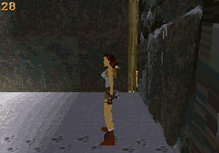

# Gouraud shading optimization

This pass improves textured shading at stock CPU clocks, retaining the existing
320×224 output, two-pixel texture sampling, draw distance, audio, checkpoints
and optional Sega CD worker. It changes neither polygon scheduling nor geometry.

| NTSC replay | Original upstream | Previous CPU worker build | This build | Gain over previous |
|---|---:|---:|---:|---:|
| Opening view | 20.00 | 26.84 | 28.50 | 6.2% |
| Turning | 22.44 | 26.72 | 26.81 | 0.4% |
| Movement | 18.84 | 18.97 | 19.34 | 2.0% |

Values are displayed page flips per emulated second, not host execution speed.
Each replay runs for 2,400 NTSC frames, excluding the first 480. The same inputs,
unmodified PicoDrive core `1890c2932234c9d30f4cd3851d02228baae8f09e`, stock clocks,
and disabled frameskip apply to both versions. The previous build is commit
`24ba5955b369be0a2fee10eaf683e111b31f7f25`.

These are replay measurements, not a universal speedup. Inputs are sampled at
render boundaries: the previous movement replay ends at `[73907,3072,25049]`,
while this one ends at `[73728,3072,25082]`. Turning also depends on render timing.
The stationary opening has the strongest workload comparability. Exact numbers,
ROM/core hashes and validation summaries are in [results-v4.json](results-v4.json)
and [benchmarks-v4.csv](benchmarks-v4.csv); the download includes raw runs.

## Changes

The Gouraud loop now shares the duplicated-color lookup already used by flat
texturing. It normalizes encoded shades 1–32 to rows 0–31, then embeds half
of a 16 KiB-aligned biased table address in the shade accumulator. Masking and doubling that address selects the correct
512-byte row while preserving the original 8-bit fractional interpolation.
The signed texture index is doubled before the word lookup. Odd endpoints
still write one byte, and tails retain exact two-pixel sampling.

The loop batches eight pairs instead of four. Flat texturing schedules the UV
update between the shade load and store. Explicit long-branch paths avoid the
assembler's branch-range expansions. The linker verifies table alignment.

Moving polygon dispatch/clipping from ROM to RAM measured no benefit and was
discarded. A wider 16-pair Gouraud experiment exceeded a literal-load reach and
was not retained. Intermediate replay numbers changed with instruction layout;
only the final playable build supplies the table above.

The lookup still contains 16 KiB of useful entries. The linker places it after
most BSS state and before the large common-state block, aligning `table + 256`
without allocating a separate prefix. Alignment and code growth increase the
static footprint by 2,016 bytes versus the previous build. Static storage ends
at `0x0603C648` (247,368 bytes from SDRAM start), leaving 14,776 bytes total,
including the reserved stacks. There are 8,624 bytes before the linker's stack
reservation. This is a real space/speed tradeoff;
further large buffers will require reclaiming memory. The ROM remains 4 MiB.

## Validation

- A fresh upstream worktree, prepared with the supplied helper, matches all
  2,556 existing raster cases and 5,112 new shade-boundary cases (encoded
  shades 1/32, ascending/descending gradients, odd endpoints and all widths). The optimized
  build matches in both SH2 recompiler and interpreter modes. FT hash:
  `1300929039`; GT: `1388686019`; boundary shades: `3137317167`.
- All 4,096 signed-divider comparisons pass. The ADPCM test decodes 592,276
  samples with the unchanged hash `1623845143`; 320 mixer cases have zero
  errors and hash `4267401245`.
- Normal movement runs with both SH2 execution modes, PAL playback, the gym,
  and City of Vilcabamba complete with zero worker faults or clipped samples.
- The repeated checkpoint replay retains its 1,488-byte save across restores;
  reset returns to the title, clears that checkpoint and restarts audio.
- Optional CD mode completes 891 CD-assisted jobs with zero worker faults.
  This is a compatibility check using the documented synthetic CD fixture,
  not evidence of an FPS gain from connecting a CD unit.

Audio/worker algorithms were not changed in this pass. The previous worker
fault-injection evidence remains in [the CPU worker report](cpu-workers.md).
Physical hardware and retail CD BIOS/drive behavior remain untested. Music,
persistent saves/settings and the remaining campaign are still unimplemented.

Build, replay and regression instructions are in the
[platform README](../../src/platform/32x/README.md).
